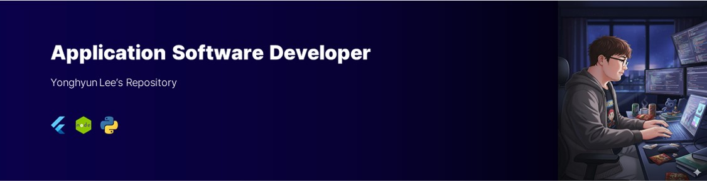

<div align="center">
  
</div>

<h1 align="center">Hello, Open-source World! 🙌</h1>

<p align="center">
  <b>Yonghyun Lee</b> · Application Software Developer<br/>
  Toward <i>human-centered physical AI</i>
</p>

<p align="center">
  
  
  <a href="mailto:yonghyunlee.me@gmail.com">
    
  </a>
</p>

---

## 👋 About Me

From the advancement of large language models to agentic AI and physical AI, we are experiencing progress unprecedented in human history. In this context, **understanding and designing human–technology interaction has become more critical than ever.**

Especially for AI systems that interact with the physical world, accurately interpreting the human body and intent is essential. At this turning point, I aim to contribute to the research and development of **human-centered physical AI.**

```yaml
name:      Yonghyun Lee
role:      Application Software Developer
location:  South Korea
focus:     [ Physical AI, Human Intent Understanding, Gait & Motion Analysis ]
contact:   yonghyunlee.me@gmail.com
```

---

## 🧮 Tech Stack

<table>
  <tr>
    <td align="right"><b>Languages</b></td>
    <td>
      
      
      
      
      
      
      
      
      
      
    </td>
  </tr>
  <tr>
    <td align="right"><b>AI / ML</b></td>
    <td>
      
      
    </td>
  </tr>
  <tr>
    <td align="right"><b>Frameworks</b></td>
    <td>
      
      
      
      
      
      
    </td>
  </tr>
  <tr>
    <td align="right"><b>Database</b></td>
    <td>
      
      
    </td>
  </tr>
  <tr>
    <td align="right"><b>Cloud</b></td>
    <td>
      
      
    </td>
  </tr>
  <tr>
    <td align="right"><b>Embedded</b></td>
    <td>
      
      
    </td>
  </tr>
  <tr>
    <td align="right"><b>Tools</b></td>
    <td>
      
    </td>
  </tr>
</table>

---

## 🏫 Education

| Year | Institution | Degree | Major |
| :--- | :--- | :--- | :--- |
| **2025** | Hanyang University | `M.S.` | Artificial Intelligence |
| **2023** | Hanyang University @ ERICA | `B.S.` | Computer Science |
| **2019** | Busan Computer Science High School | `High School` | Smart Software |
| **2015–2017** | Information Security Gifted Education Center<br/><sub>Affiliated with the Ministry of Education</sub> | `Gifted Education` | Security |
| **2012–2014** | Secondary Information Science Gifted Education Center<br/><sub>Busan Metropolitan Office of Education</sub> | `Gifted Education` | Application Software |

---

## 🎞️ Projects

<a href="https://www.heaven-letter.app">
  
</a>

### 1. Letters from Heaven (천국에서 온 편지) · <a href="https://www.heaven-letter.app">heaven-letter.app</a>

> A comforting letter from your far-future self, written by AI from your birth chart (Saju) — delivered as 3–4 images in about 20 seconds.

A live consumer web service I designed, built and operate solo. Users enter a nickname and birth date/time; the service calculates their Four Pillars of Destiny (Saju) and asks Claude to write a letter from *the self who has lived a full life* to *the self who is struggling today*, then renders it onto illustrated letter paper. It is a creative piece inspired by Saju — it never predicts real lifespan or health — and it is designed with safety in mind: peaceful depictions only, a banned-expression filter, a softer "cheer letter" for minors, and crisis-hotline guidance.

<p>
  
  
  
</p>

**📈 KPIs** &nbsp;<sub>first month · Oct 10 – Nov 6, 2026 · Google Analytics 4 & server logs</sub>

| Metric | Value |
| :--- | :--- |
| Monthly active users | **2.4K** (2.4K new users) |
| Letters written & delivered | **~2,200** in 30 days |
| Avg. engagement time per user | **1 min 57 s** |
| Events tracked | **32K** |
| Acquisition | **~75%** of new users from Google organic search (1.8K) — no paid ads |
| AI cost per letter | **≈ ₩18 (~$0.013)** on Claude Sonnet |
| Markets | Korea → **Japan** (Japanese version launched Nov 2026) |

**What I built**

- **Saju engine from scratch** — solar terms via astronomical calculation, historical Korean & Japanese time-zone/DST tables, local-mean-time correction, 10-year luck cycles (대운)
- **LLM pipeline** — Claude API with structured JSON output, server-side model fallback, per-language prompts (KO/JA), safety filter with retry and a template fallback, token/cost tracking per day
- **Image rendering** — letters rendered server-side to JPG (satori + sharp) with custom glyph-measured line breaking, including Japanese kinsoku rules
- **Growth & retention** — Kakao/LINE/Instagram Story sharing, an on-device "letter box" (IndexedDB), a time capsule that emails your reply back after 100 days or a year (AES-256-GCM, cron)
- **Operations** — Cloudflare Turnstile, IP-hash + global daily quotas, Upstash Redis, GA4 funnel events, AdSense, SEO (JSON-LD, hreflang), GitHub Actions CI, Vercel

**Role** &nbsp;`Solo Founder` &nbsp;`Product & UX Design` &nbsp;`Full-stack Developer` &nbsp;`LLM Prompt Engineering` &nbsp;`Growth & Marketing`


<br/>


### 2. AI-Assisted Home Upper-Limb Rehabilitation Device

> Trajectory collection and AI-based posture voice feedback for at-home rehabilitation exercises.

To mitigate regional imbalances in medical infrastructure, we developed a home-based upper-limb rehabilitation device integrated with AI (**Variational Autoencoder**) and a voice-based feedback system. The system has been filed for a patent and is currently under examination by a South Korean government authority.

**Role** &nbsp;`Team Leader` &nbsp;`Web Application Developer` &nbsp;`Circuit Design (Arduino) & Embedded SW`


<br/>


### 3. Video Snapshot Retrieval with LSH-based FALCONN

> Fast nearest neighbor search over large-scale video data.

Reviewed research papers on **Locality-Sensitive Hashing** and developed a feature to capture specific moments within videos by applying the LSH-based **FALCONN** (FAst Lookups of Cosine and Other Nearest Neighbors) library for large-scale data exploration to video data.

**Role** &nbsp;`Applied LSH-based FALCONN to video data for fast NN search`


<br/>


### 4. AI Medical Chatbot with LLM & Tabular Classification

> Supplement recommendation from clinical diagnostic data through a conversational interface.

Conducted as part of coursework during a master's program in collaboration with an industry partner. The goal was to develop a service that interacts with users through a chatbot interface and recommends nutritional supplements offered by the company, based on historical clinical diagnostic tabular data. The service was implemented by integrating OpenAI's GPT model with a **Retrieval-Augmented Generation (RAG)** approach tailored for tabular data.

**Role** &nbsp;`AI Agent Developer` &nbsp;`Web-based Chatbot Service Developer`


---

## 📜 Research Papers


### Clinical Trials of GPE-based Muscle Support Algorithm for Robotic Hip Exoskeleton: A Pilot Study

<p>
  
  
  <a href="https://doi.org/10.1038/s41598-025-15385-y">
    
  </a>
</p>

<details>
<summary><b>📖 Read Abstract</b></summary>

<br/>

With the advent of an aging society, the lack of physical activity has become a major concern, leading to various age-related diseases. To prevent such issues, research on wearable robots aimed at improving gait has been actively pursued. Among them, exoskeleton robots, a widely used approach, require an accurate understanding of the user's gait cycle for effective control. Various studies have explored gait cycle detection and prediction methods depending on the type of gait robot platform and the use of sensors. However, a major challenge in gait cycle prediction algorithms remains the issue of nonlinear predictive trajectories.

In this study, a robotic hip exoskeleton (RHE) was utilized to implement an enhanced gait phase estimation (GPE) algorithm integrated with a muscle support system. Participants were divided into two groups (Group A and Group B) based on their initial gait performance, and the effectiveness of gait rehabilitation training was evaluated.

The results showed that in the 10-meter walk test (10MWT), walking time decreased by approximately **5% in Group A** and **27% in Group B**. In the 6-minute walk test (6MinWT), walking distance increased by approximately **1% in Group A** and **14% in Group B**. Group B, which had lower initial gait performance, showed a greater gait performance improvement rate compared to Group A. Through the gait performance results of the two groups, the applicability of the GPE-based muscle support algorithm was confirmed.

</details>

<br/>


### Linearized Gait Phase Estimation Using BiLSTM

<p>
  
  
  <a href="https://doi.org/10.1109/ICEIC64972.2025.10879626">
    
  </a>
</p>

<details>
<summary><b>📖 Read Abstract</b></summary>

<br/>

This paper presents a novel deep learning-based approach to address time-delay challenges arising from nonlinear transformations in Gait Phase Estimation, a critical factor in analyzing human gait for lower limb exoskeleton robots. The proposed model leverages hip joint angles and angular velocities as feature data, organized using a sliding window technique, to predict the **Linearized Gait Phase (LGP)** — a continuous representation of gait progression between Heel Strikes.

Motivated by the need for real-time and precise gait phase estimation to enhance exoskeleton control, a **Bidirectional LSTM** network was employed to reduce delays and improve accuracy. The model's effectiveness was validated through comprehensive performance evaluations using MAE, RMSE, MSE, and R² score, alongside a temporal analysis of delay reduction.

| Metric | Result |
| :--- | :--- |
| MAE | 2.8 ± 0.8 % |
| RMSE | 3.9 ± 1.2 % |
| MSE | 0.1 ± 0.1 % |
| R² Score | 98.1 ± 1.8 % |

Particularly, temporal analysis revealed a marked improvement, achieving an MAE of **0%**, compared to 2.74 ± 0.92% reported in prior studies. These findings underscore the proposed model's potential for real-time gait phase estimation, offering significant implications for enhancing the responsiveness and adaptability of lower limb exoskeleton robots.

</details>

---

## 📬 Contact Me

<div align="center">
  <a href="mailto:yonghyunlee.me@gmail.com">
    
  </a>
</div>

<br/>

<div align="center">
  <sub>Thanks for stopping by! 🌱</sub>
</div>
